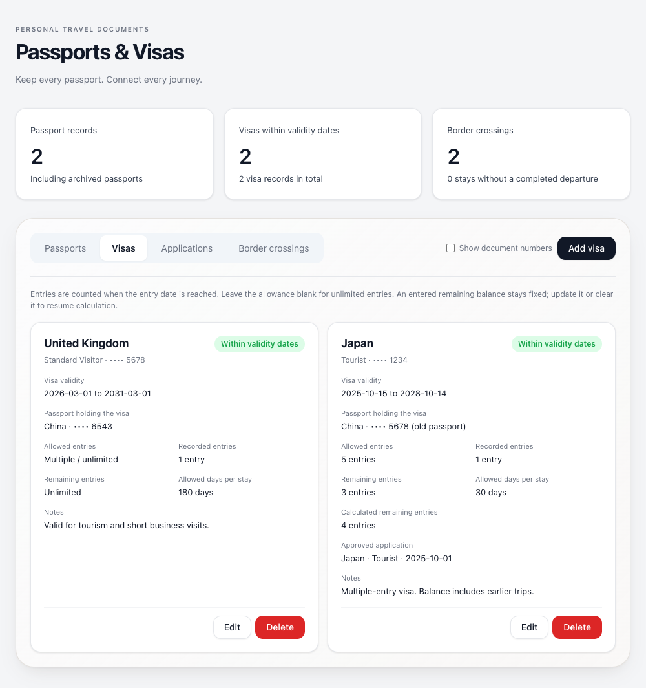
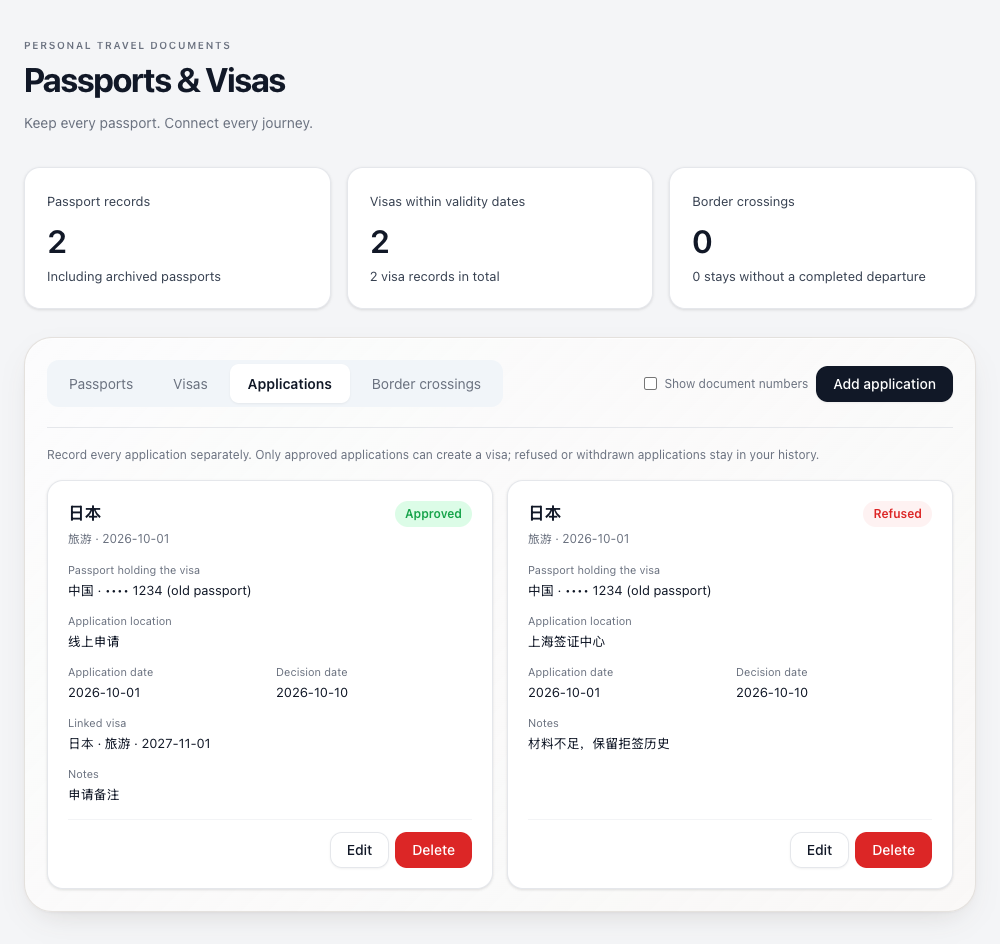

# Passports & Visas

English | [简体中文](README.zh-CN.md)

A TREK page plugin for your personal passports, visas, visa applications and border crossings. Version **1.0.0** supports TREK **>=5.1.4 <6.0.0**, using plugin API v1.

## What it does

- **Passports:** keep current and archived passports, including the holder, number, issuing country or region, issue date and expiry date. Passports within their validity dates appear first in passport selectors; historical passports remain selectable.
- **Visas:** record the destination, type, number, validity dates, entry allowance and allowed days per stay. A valid visa can remain associated with an old passport while you record travel using a new passport.
- **Applications:** keep separate attempts for the same country, with Submitted, Under review, Approved, Refused or Withdrawn status. Each record includes an application location, application date, optional decision date and notes. An approved application can create one linked visa after you enter its visa details. A refusal does not create a usable visa. Unlink or delete the linked visa before changing an application's result, passport or country.
- **Border crossings:** record entry and departure locations independently as free text, including different countries, cities or border checkpoints. Entry and departure dates appear side by side. A visa is optional for visa-free travel or incomplete historical records.
- **Hong Kong and Macao permits:** optionally enable a separate permit and crossing module in the plugin's instance settings. Keep the permit and its current Hong Kong and Macao endorsements, choose from six endorsement types, use built-in port lists, and track used and remaining endorsement entries from recorded visits.
- **Language:** the interface, confirmations and validation messages follow TREK's interface language. Date fields use the browser's native date picker. English is the default and fallback; Simplified Chinese is also included. Switching languages preserves an open form's unsaved values.

Entry usage counts linked crossings whose entry date has been reached; future entries do not reduce the allowance. A blank allowance means unlimited entries. You can enter a fixed remaining balance to replace the calculated value. **That balance does not automatically decrease after later crossings:** update it yourself or clear it to resume calculation. Zero is a valid value.

Stay durations use calendar days and include both arrival and departure. Same-day travel counts as one day. An ongoing stay is counted through the browser's local date; a future entry counts as zero days. A future departure date does not add days beyond today. You can enter a different duration or clear it to restore calculation. Country-specific rules such as rolling 90/180-day limits are not calculated.

All forms use Notes rather than a separate adjustment-reason field. Adjustment reasons from older records are retained in Notes when displayed and saved. Referenced passports, visas and applications cannot be deleted until their dependent records are unlinked or removed.

The plugin loads records when opened and after a successful create, edit or delete. A Retry button appears only when loading fails. Deletion uses TREK's shared confirmation dialog.

## Screenshots

The screenshots use demonstration data. User-entered names and notes are preserved in their original language.

## Permissions

| Permission | Purpose |
| --- | --- |
| `db:own` | Store the plugin's records in its isolated SQLite database, scoped to the authenticated TREK account. |
| `hook:user-data` | Include these records in TREK's account data export and erase them when that account is deleted. |

The plugin manages the signed-in account's own records. It does not request trip access, outbound network access, notifications or scheduled jobs. Document numbers are masked in record cards by default and are visible while editing. Data is stored in TREK's plugin database; there is no additional field-level encryption. Include that database in your instance backups and control access to the database files.

## Setup

Installation, development and validation instructions are in [CONTRIBUTING.md](CONTRIBUTING.md).

## License

[AGPL-3.0-only](LICENSE), consistent with the TREK shared components included in this plugin.
