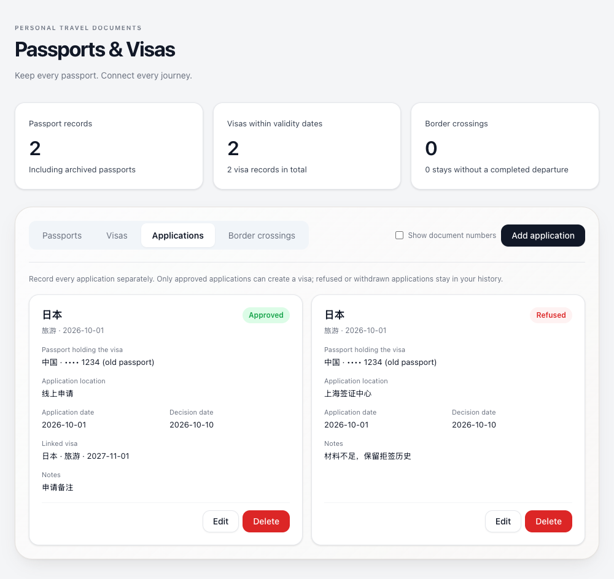

# 护照与签证

[English](README.md) | 简体中文

一个用于管理本人护照、签证、签证申请及出入境记录的 TREK 页面插件。版本 **1.1.1**，兼容 TREK **>=5.0.0 <6.0.0**，使用插件 API v1。

## 功能

- **护照档案：** 记录持有人、号码、签发国家或地区、签发日期及有效期，支持当前护照和旧护照归档。护照下拉列表优先显示有效期内的护照，历史护照仍可选择。
- **签证档案：** 记录国家或地区、类型、号码、有效期、允许入境次数及每次允许停留天数。签证所属护照与出行护照分别关联，可保留旧护照上的有效签证，同时记录使用新护照的出入境。
- **签证申请：** 同一国家可分别记录多次申请，支持已提交、审核中、获批、拒签、撤回五种状态，并保存申请地点、申请日期、可选的结果日期及备注。获批后填写签证信息，可生成一份关联签证；拒签不生成有效签证。修改已关联申请的结果、护照或国家前，须先解除或删除关联签证。
- **出入境记录：** 先选出境国家或地区，再选入境国家或地区和过境日期。城市或口岸可选填。填写返程日期可一次保存两条记录，返程反转出入境方向并沿用出行护照。两条记录可分别编辑，签证可选填。
- **港澳通行证：** 可在插件实例设置中启用独立的通行证和出入境记录模块。每本证件分别保存当前香港、澳门签注，支持个人旅游、团队旅游、探亲、商务、逗留和其他六类；口岸可从内置列表选择；已用及剩余签注次数按关联的入境记录自动计算。
- **多语言：**页面、确认弹窗及校验提示随 TREK 界面语言切换。日期字段使用浏览器原生日期选择器，由浏览器和设备决定外观。默认及回退语言为英语，同时提供简体中文；切换语言会保留编辑中的表单内容。

入境次数按已到过境或入境日期的关联记录计算，未来入境不扣次数。允许入境次数留空表示不限。可以填写固定的剩余次数以覆盖计算结果；**后续出入境不会自动扣减这个固定值**，需要自行更新，或清空后恢复自动计算。零也是有效值。

所有表单统一使用备注，不再提供独立的调整说明输入框。旧记录中的调整说明会并入备注显示并保存在再次编辑后的记录中。仍被引用的护照、签证或申请需要先解除关联，才能删除。

进入页面及新增、编辑、删除成功后自动读取数据，仅在读取失败时显示“重试”。删除操作复用 TREK 的共享确认弹窗。

## 截图

截图使用演示数据。用户填写的名称和备注保留原文，不随界面语言翻译。

## 权限与数据

| 权限 | 用途 |
| --- | --- |
| `db:own` | 将记录保存在插件独立的 SQLite 数据库中，所有读写按登录账户隔离。 |
| `hook:user-data` | 对接 TREK 的账户数据导出，并在删除账户时清除该账户的插件记录。 |

插件仅管理当前账户本人的记录，不请求行程、联网、通知或定时任务权限。列表中默认遮挡证件号码，编辑时可查看完整号码。记录保存在 TREK 管理的插件数据库中，未额外实现字段加密；请随实例一起备份，并控制数据库文件的访问权限。

## 贡献说明

安装、开发与测试步骤请参阅 [CONTRIBUTING.zh-CN.md](CONTRIBUTING.zh-CN.md)。

## 许可证

[AGPL-3.0-only](LICENSE)，与插件所复用的 TREK 共享组件保持一致。
